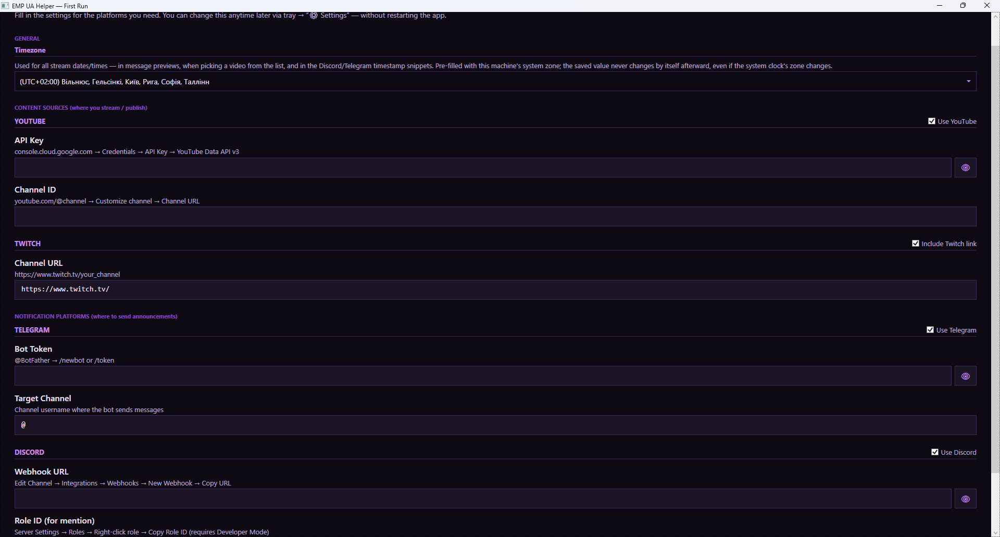
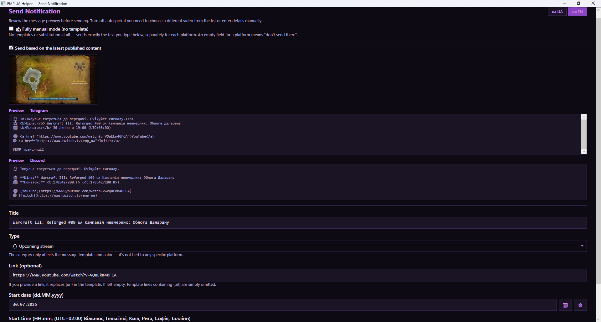
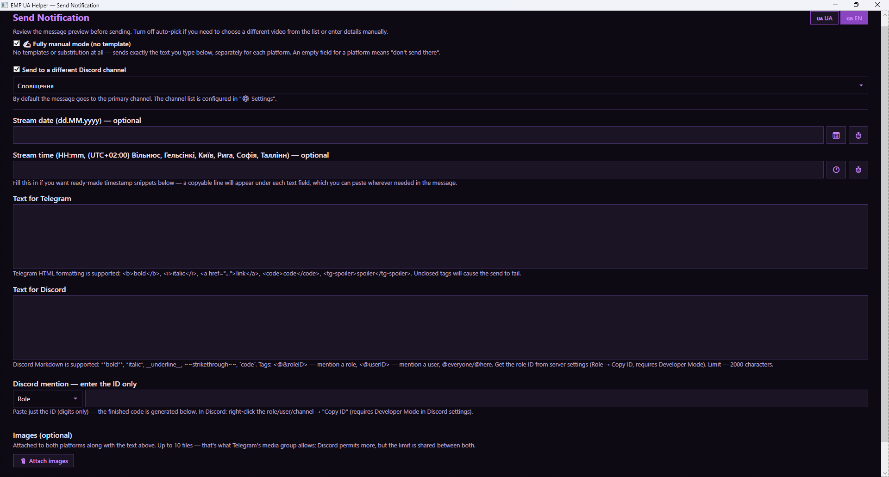
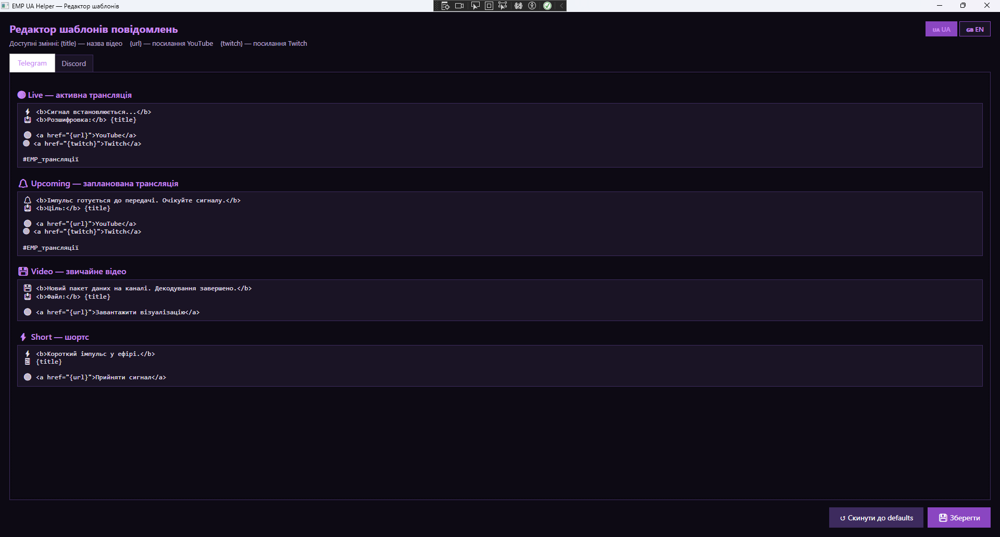

# EMP UA Helper

**UA:** Десктопний інструмент для одночасного надсилання сповіщень про трансляції та відео у Telegram і Discord одним кліком. Кожна платформа — джерело контенту (YouTube, Twitch) чи платформа сповіщень (Telegram, Discord) — вмикається і вимикається незалежно, будь-коли, без перезапуску програми.
**EN:** A desktop tool for sending simultaneous stream and video notifications to Telegram and Discord in one click. Every platform — a content source (YouTube, Twitch) or a notification platform (Telegram, Discord) — can be toggled independently, anytime, without restarting the app.

---

## ✨ Можливості / Features

- **UA:** Одночасна відправка в Telegram і Discord, з окремим прикладом повідомлення для кожної платформи перед відправкою / **EN:** Simultaneous Telegram and Discord notifications, with a separate message preview for each platform before sending
- **UA:** Автоматичне визначення типу контенту через YouTube: трансляція, анонс, відео, шортс / **EN:** Auto-detection of content type via YouTube: live stream, upcoming, video, short
- **UA:** Локальний кеш YouTube-контенту — заплановані трансляції не губляться, навіть якщо випадуть за межі останніх ~15 записів фіду каналу через активну публікацію іншого контенту / **EN:** Local YouTube content cache — scheduled streams aren't lost even if they fall outside the channel's last ~15 feed entries due to other active publishing
- **UA:** Кожна платформа опціональна — Telegram, YouTube, Discord, Twitch вмикаються/вимикаються незалежно (потрібна хоча б одна платформа сповіщень: Telegram або Discord) / **EN:** Every platform is optional — Telegram, YouTube, Discord, Twitch toggle independently (at least one notification platform, Telegram or Discord, is required)
- **UA:** Вікно "⚙️ Налаштування" в треї — зміна комбінації платформ у будь-який момент, без перезапуску програми / **EN:** "⚙️ Settings" window in the tray — change the platform combination anytime, without restarting the app
- **UA:** "📡 Надіслати сповіщення" — єдине вікно з живим прикладом перед відправкою: автопідбір останнього опублікованого контенту (за бажанням), вибір конкретного відео зі списку з мініатюрою, назвою та реальною датою публікації/трансляції, або повністю ручний режим без жодного шаблону / **EN:** "📡 Send Notification" — a single window with a live preview before sending: auto-pick the latest published content (optional), choose a specific video from a list with a thumbnail, title, and real publish/broadcast date, or a fully manual mode with no template at all
- **UA:** ✍️ Повністю ручний режим — окремі текстові поля для Telegram і Discord, без будь-якої підстановки шаблону: відправляється рівно те, що введено / **EN:** ✍️ Fully manual mode — separate text fields for Telegram and Discord, with zero template substitution: sends exactly what was typed
- **UA:** У ручному режимі — генератори готових до копіювання позначок часу (Telegram-рядок, Discord-тег) і згадок Discord (роль/користувач/канал за самим ID) / **EN:** In manual mode — generators for ready-to-copy timestamp snippets (Telegram string, Discord tag) and Discord mentions (role/user/channel by ID alone)
- **UA:** У ручному режимі — прикріплення до 10 зображень (скріншотів, фото) до однієї публікації, спільних для Telegram і Discord; порядок можна змінити (кнопки ◀/▶ або перетягування мишею), а по кліку на мініатюру відкривається перегляд у повний розмір / **EN:** In manual mode — attach up to 10 images (screenshots, photos) to a single post, shared between Telegram and Discord; the order can be changed (◀/▶ buttons or mouse drag), and clicking a thumbnail opens a full-size preview
- **UA:** Вікно "📡 Надіслати сповіщення" перевіряє з'єднання з увімкненими платформами ще до натискання "Надіслати" (автоматично під час відкриття й повторно за кнопкою 🔄) — лише read-only запити, нічого не публікується і не видно підписникам / **EN:** The "📡 Send Notification" window checks connectivity with the enabled platforms before "Send" is pressed (automatically on open, and again via the 🔄 button) — read-only requests only, nothing is posted or visible to subscribers
- **UA:** Реальний статус відправки окремо для Telegram і Discord — Discord-вебхук явно підтверджує доставку (`?wait=true`), а не вважається успішним мовчки / **EN:** A real send status for Telegram and Discord separately — the Discord webhook explicitly confirms delivery (`?wait=true`) rather than being silently assumed successful
- **UA:** 📡 Опційно — вікно відправки відкривається одразу при запуску програми ("⚙️ Налаштування" → Загальне) / **EN:** Optional — the send window opens right when the app starts ("⚙️ Settings" → General)
- **UA:** 🧪 Тестова відправка — Telegram в особистий чат з ботом, Discord у вебхук окремого тестового каналу; підписники основних каналів тесту не бачать / **EN:** 🧪 Test send — Telegram to the private chat with the bot, Discord to a separate test channel's webhook; subscribers of the main channels never see the test
- **UA:** Окреме вікно з результатом відправки по кожній платформі — завжди, лише при помилці або ніколи (⚙️ Налаштування → Загальне) / **EN:** A separate send-result window with the result per platform — always, only on failure, or never (⚙️ Settings → General)
- **UA:** Захист від дублікатів — повторне натискання "Надіслати" для того самого вмісту не повторює відправку на платформу, яка вже підтвердила успіх, без окремого підтвердження користувача / **EN:** Duplicate-send protection — pressing "Send" again for the same content won't resend to a platform that already confirmed success, without the user's separate confirmation
- **UA:** У ручному режимі — лічильник символів з реальним лімітом (Telegram залежить від наявності вкладеного зображення — підпис коротший за звичайний текст). Перевищення блокує відправку на цю платформу; якщо лишається хоча б одна платформа в межах ліміту, перед відправкою запитується підтвердження часткової відправки лише туди / **EN:** In manual mode — a character counter with the real limit (Telegram's depends on whether an image is attached — a caption is shorter than plain text). Exceeding it blocks sending to that platform; if at least one platform stays within its limit, a confirmation prompt offers a partial send to just that platform
- **UA:** У ручному режимі — швидкий вибір збереженої ролі Discord зі списку (⚙️ Налаштування) замість введення ID вручну щоразу / **EN:** In manual mode — quick-pick a saved Discord role from a list (⚙️ Settings) instead of typing the ID by hand every time
- **UA:** У ручному режимі — кнопки форматування тексту (жирний/курсив/підкреслення/закреслення/код/спойлер/посилання), що застосовуються до виділеного тексту, або вставляють пару тегів/символів на місці курсора, якщо нічого не виділено / **EN:** In manual mode — text formatting buttons (bold/italic/underline/strikethrough/code/spoiler/link) that apply to the selected text, or, if nothing is selected, insert a pair of tags/symbols at the caret
- **UA:** Часовий пояс налаштовується (не захардкоджений), коректно враховує перехід літній/зимовий час / **EN:** Configurable timezone (not hardcoded), correctly handles daylight saving transitions
- **UA:** Кнопки 📅🕐⏱ для всіх полів дати/часу — календар, вибір години/хвилини, підстановка поточного часу / **EN:** 📅🕐⏱ buttons for every date/time field — calendar, hour/minute picker, fill-in-current-time
- **UA:** Кілька іменованих каналів Discord з вибором, куди надіслати конкретне сповіщення / **EN:** Multiple named Discord channels with a picker for where a specific notification goes
- **UA:** Різні шаблони повідомлень для кожного типу і платформи, з вбудованим редактором / **EN:** Separate message templates per content type and platform, with a built-in editor
- **UA:** Шаблони автоматично прибирають рядки з посиланнями, яких немає (наприклад, якщо Twitch вимкнено) — жодних битих посилань / **EN:** Templates automatically drop lines referencing links that aren't set (e.g. if Twitch is disabled) — no dangling links
- **UA:** М'яке попередження, якщо вставлене посилання не схоже на YouTube чи Twitch — не блокує відправку, лише підказка / **EN:** A soft warning if the pasted link doesn't look like YouTube or Twitch — doesn't block sending, just a hint
- **UA:** Discord embed з thumbnail, кольором і пінгом ролі / **EN:** Discord embed with thumbnail, color and role mention
- **UA:** Telegram HTML-форматування з превью посилання; якщо Telegram не може побудувати прев'ю YouTube, анонс автоматично йде як фото з мініатюрою (або завжди — перемикачем у налаштуваннях) / **EN:** Telegram HTML formatting with link preview; if Telegram can't build a YouTube preview, the announcement automatically goes as a photo with the thumbnail (or always — via a settings toggle)
- **UA:** Секретні поля (токени, API-ключі, webhook URL) приховані за замовчуванням з кнопкою перегляду 👁 / **EN:** Secret fields (tokens, API keys, webhook URL) are masked by default with a 👁 reveal button
- **UA:** Двомовний інтерфейс UA/EN у кожному вікні / **EN:** Bilingual UA/EN interface in every window
- **UA:** Живе в треї — не заважає робочому столу / **EN:** Lives in the system tray — stays out of your way
- **UA:** Логування в файл (`logs/`), включно з кожним HTTP-запитом до Telegram і Discord (статус, тривалість, заголовки rate-limit, тіло помилки) — без токенів і URL вебхуків / **EN:** Logging to file (`logs/`), including every HTTP request to Telegram and Discord (status, duration, rate-limit headers, error body) — without tokens or webhook URLs

---

## 🚀 Початок роботи / Getting Started

### Вимоги / Requirements

**UA:** Windows 10/11 x64/x86. Self-contained версії (`win-x64`, `win-x86`) не потребують встановленого .NET. Версія `generic` потребує [.NET 10 Desktop Runtime](https://dotnet.microsoft.com/download/dotnet/10.0).
**EN:** Windows 10/11 x64/x86. Self-contained builds (`win-x64`, `win-x86`) require no .NET installation. The `generic` build requires [.NET 10 Desktop Runtime](https://dotnet.microsoft.com/download/dotnet/10.0).

### Встановлення / Installation

**UA:**
1. Завантажте останній реліз у розділі [Releases](../../releases/latest)
2. Розпакуйте в будь-яку папку
3. Запустіть `EMP.UAHelper.WPF.exe`
4. Оберіть потрібні вам платформи та заповніть поля першого запуску

**EN:**
1. Download the latest release from [Releases](../../releases/latest)
2. Extract to any folder
3. Run `EMP.UAHelper.WPF.exe`
4. Select the platforms you need and fill in the first-run setup fields

### Налаштування API / API Setup

Кожна секція має власний перемикач — заповнюй лише ті платформи, які реально використовуєш.
Each section has its own toggle — only fill in the platforms you actually use.

| Сервіс / Service | UA: Де отримати / EN: Where to get |
|---|---|
| Telegram Bot Token | [@BotFather](https://t.me/BotFather) → `/newbot` |
| YouTube API Key | [Google Cloud Console](https://console.cloud.google.com) → Credentials → API Key → YouTube Data API v3 |
| Discord Webhook URL | **UA:** Редагувати канал → Інтеграції → Вебхуки → Новий вебхук → Скопіювати URL   **EN:** Edit Channel → Integrations → Webhooks → New Webhook → Copy URL |
| Discord Role ID | **UA:** Налаштування сервера → Ролі → ПКМ на роль → Скопіювати ID ролі (потрібен режим розробника)   **EN:** Server Settings → Roles → Right-click role → Copy Role ID (requires Developer Mode) |

**UA:** Той самий Discord Webhook URL вище — це основний канал. У "⚙️ Налаштування" в секції Discord є ще два необов'язкові поля: назва основного каналу (підпис для списку вибору у вікні надсилання, за замовчуванням "Основний канал") і "Додаткові канали Discord" — кнопкою ➕ додаєш будь-яку кількість пар назва+вебхук для інших каналів (наприклад, тестового чи іншомовного). З двома й більше каналами у вікні "📡 Надіслати сповіщення" з'являється можливість обрати, куди саме йде конкретне сповіщення (докладніше — нижче).
**EN:** The Discord Webhook URL above is the primary channel. Under "⚙️ Settings" in the Discord section there are two more optional fields: a primary channel name (a label for the picker in the send window, defaults to "Primary channel") and "Additional Discord channels" — the ➕ button lets you add any number of name+webhook pairs for other channels (e.g. a test channel or a different-language one). With two or more channels configured, the "📡 Send Notification" window gains the option to pick where a specific notification goes (more on this below).

**UA:** Поле Discord Role ID вище — це роль, яку автоматичні сповіщення пінгують завжди. Окремо від нього в тій самій секції є "Збережені ролі Discord" — список будь-якої кількості пар назва+ID (аналогічно додатковим каналам), які з'являються як список швидкого вибору в генераторі згадок у вікні ручної відправки, замість введення ID наосліп щоразу. Основна роль (Discord Role ID) теж з'являється в цьому списку автоматично, позначена як "Роль зі сповіщень (основна)" — дублювати її в "Збережені ролі" не потрібно.
**EN:** The Discord Role ID field above is the role automatic notifications always ping. Separately, the same section has "Saved Discord roles" — a list of any number of name+ID pairs (same pattern as the additional channels), which show up as a quick-pick list in the mention generator in the manual-send window, instead of typing the ID blindly every time. The primary role (Discord Role ID) also appears in that list automatically, labeled "Role from notifications (primary)" — no need to duplicate it into "Saved Discord roles".

---

## ⚙️ Зміна платформ будь-коли / Changing Platforms Anytime

**UA:** Відкрий іконку в треї → "⚙️ Налаштування", щоб змінити комбінацію Telegram/YouTube/Discord/Twitch будь-якого дня — без видалення `appsettings.json` і без повторного проходження першого запуску. Зміни застосовуються одразу.
**EN:** Open the tray icon → "⚙️ Settings" to change the Telegram/YouTube/Discord/Twitch combination any day — without deleting `appsettings.json` and without going through First Run again. Changes apply immediately.

---

## 🕒 Часовий пояс / Timezone

**UA:** І вікно першого запуску, і "⚙️ Налаштування" мають поле "Часовий пояс" — воно визначає, як інтерпретується дата/час у прикладах повідомлень, у списку кандидатів з YouTube і в позначках часу для Discord/Telegram (у ручному режимі). При першому запуску поле автоматично підставляється системною зоною цього комп'ютера — нічого обирати не обов'язково. Значення зберігається явно в `appsettings.json` і не змінюється саме собою, навіть якщо системний час комп'ютера пізніше переналаштують (відрядження, VPN тощо) — це свідоме рішення, щоб уже заплановані анонси не "поплили". Літній/зимовий перехід усередині обраної зони обробляється коректно й автоматично. Якщо поля в `appsettings.json` немає, використовується київський час.
**EN:** Both the first-run window and "⚙️ Settings" have a "Timezone" field — it determines how the date/time is interpreted in message previews, in the YouTube candidate list, and in the Discord/Telegram timestamp snippets (manual mode). On first run, the field is auto-filled with this machine's system zone — nothing has to be picked manually. The value is saved explicitly into `appsettings.json` and never changes by itself afterward, even if the machine's system clock zone changes later (travel, VPN, etc.) — that's intentional, so already-scheduled announcements don't drift. Daylight saving transitions within the chosen zone are handled correctly and automatically. If the field is missing from `appsettings.json`, Kyiv time is used.

---

## 📡 Надіслати сповіщення / Send Notification

**UA:** Відкрий трей → "📡 Надіслати сповіщення". Це єдине вікно для будь-якого анонсу — з живим прикладом повідомлення для кожної увімкненої платформи (Telegram і Discord окремо), ще до відправки.

Якщо YouTube увімкнено, за замовчуванням активний автопідбір "Надсилати за останнім опублікованим контентом" (той самий пріоритет: активна трансляція → анонс → відео/шортс). Знявши цю галочку, можна натомість обрати конкретне відео зі списку — кожен пункт показує мініатюру, назву й реальну дату публікації або старту трансляції (не дату локального кешування), що зручно, коли кілька публікацій мають схожі назви чи превью того самого дня.

Список включає не лише останні ~15 записів з YouTube RSS-фіду (обмеження самого YouTube), а й раніше збережені заплановані трансляції — навіть ті, що вже випали з цього вікна через активну публікацію іншого контенту. Заплановані трансляції зберігаються локально в кеші без обмеження за часом, доки не настане їхня дата.

Поле "Заголовок" і тип (Live/Upcoming/Video/Short — категорія лише впливає на шаблон і колір, не привʼязана до платформи) підставляються в активні шаблони. Поле "Посилання" необов'язкове: якщо вказане — підставляється замість `{url}`; якщо порожнє — рядки шаблону з `{url}` просто не входять у повідомлення. Якщо вставлене посилання не схоже ні на YouTube, ні на Twitch — з'явиться м'яке попередження (не блокує відправку).

Поля дати й часу початку трансляції (для типу Upcoming) мають кнопки 📅 (відкрити календар), 🕐 (обрати годину/хвилину) і ⏱ (підставити поточні дату/час у зоні з "⚙️ Налаштування") — набирати вручну необов'язково, але можна.

**EN:** Open the tray → "📡 Send Notification". This is the single window for any announcement — with a live message preview for each enabled platform (Telegram and Discord separately), before you send anything.

If YouTube is enabled, the "Send based on the latest published content" auto-pick is on by default (same priority: live stream → upcoming → video/short). Unchecking it lets you instead choose a specific video from a list — each entry shows a thumbnail, title, and the real publish or broadcast date (not the local caching date), which helps when several uploads share a similar title or thumbnail on the same day.

The list includes not just the last ~15 entries from the YouTube RSS feed (a YouTube limitation), but also previously cached scheduled streams — even ones that already fell out of that window due to other content being published. Scheduled streams are kept in the local cache with no time limit until their date arrives.

The "Title" field and type (Live/Upcoming/Video/Short — the category only affects the template and color, it's not tied to a platform) are inserted into the active templates. The "Link" field is optional: if provided, it replaces `{url}`; if left empty, template lines containing `{url}` are simply omitted. A soft warning appears if the pasted link doesn't look like YouTube or Twitch (it doesn't block sending).

The stream start date/time fields (for the Upcoming type) have 📅 (open a calendar), 🕐 (pick hour/minute) and ⏱ (fill in the current date/time in the zone set under "⚙️ Settings") buttons — manual typing is optional but fully supported.

---

**UA:** Скріншот вище показує типовий (шаблонний) режим. Галочка "✍️ Повністю ручний режим (без шаблону)" перемикає вікно в інший режим, без жодної підстановки: замість заголовка/типу/посилання/дати з'являються два окремі текстові поля — для Telegram і для Discord. Відправляється рівно те, що введено; порожнє поле означає "не надсилати на цю платформу". Поля розділені навмисно, бо в кожної платформи свій синтаксис: Telegram підтримує HTML-теги (`<b>`, `<i>`, `<a href>`, `<code>`, `<tg-spoiler>` тощо — розпізнаються, якщо вписати їх вручну), а Discord — власний Markdown (`**жирний**`, `*курсив*`, `` `код` ``) і теги згадувань (`<@&ID_ролі>` для ролі, `<@ID_користувача>` для користувача, `@everyone`/`@here`) прямо в тексті, без додаткового екранування.

У цьому ж режимі є необов'язкові поля "Дата трансляції" і "Час трансляції" (у часовому поясі з "⚙️ Налаштування", за замовчуванням — системна зона цього комп'ютера) — спільні для обох платформ. Якщо їх заповнити, під кожним текстовим полем з'являється готова позначка часу: для Telegram — читабельний рядок на кшталт "29 липня о 19:00 (UTC+3)", для Discord — тег `<t:...:F> (<t:...:R>)`, який Discord сам відображає в локальному часі кожного читача. Позначки лише генеруються (для копіювання кнопкою 📋 або виділенням) — нікуди автоматично не вставляються, бо це суперечило б суті ручного режиму.

**EN:** The screenshot above shows the default (template) mode. The "✍️ Fully manual mode (no template)" checkbox switches the window into a different mode, with zero substitution: instead of title/type/link/date, two separate text fields appear — one for Telegram, one for Discord. Whatever is typed is sent exactly as-is; an empty field means "don't send to that platform." The fields are kept separate on purpose, since each platform has its own syntax: Telegram supports HTML tags (`<b>`, `<i>`, `<a href>`, `<code>`, `<tg-spoiler>`, etc. — recognized if typed by hand), while Discord uses its own Markdown (`**bold**`, `*italic*`, `` `code` ``) and mention tags (`<@&roleID>` for a role, `<@userID>` for a user, `@everyone`/`@here`) directly in the text, no extra escaping needed.

The same mode has optional "Stream date" and "Stream time" fields (in the timezone set under "⚙️ Settings", defaulting to this machine's system zone) — shared by both platforms. Filling them in reveals a ready-made timestamp snippet under each text field: for Telegram, a readable string like "29 July at 19:00 (UTC+3)"; for Discord, a `<t:...:F> (<t:...:R>)` tag that Discord renders in each reader's own local time. Snippets are only generated (copyable via the 📋 button or by selecting the text) — nothing is auto-inserted, since that would defeat the purpose of manual mode.

**UA:** За тим самим принципом працює поле "Згадка Discord" — вводиться лише ID (самі цифри), а готовий код генерується нижче з кнопкою копіювання. Тип обирається списком, бо синтаксис у Discord різний і переплутати легко: роль — `<@&ID>`, користувач — `<@ID>`, канал — `<#ID>`. ID беруться в Discord через ПКМ по ролі/користувачу/каналу → "Копіювати ID" (потрібен режим розробника в налаштуваннях Discord). Якщо замість ID вставити цілий скопійований тег, поле його відхилить — інакше вийшов би вкладений сам у себе тег, який Discord показав би як звичайний текст. Якщо в "⚙️ Налаштування" заведено хоча б одну збережену роль, для типу "Роль" під полем з'являється додатковий список для швидкого вибору — вибір автоматично підставляє ID ролі, а ручне введення лишається доступним.

**EN:** The "Discord mention" field works on the same principle — you enter just the ID (digits only) and the finished code is generated below with a copy button. The type is picked from a list because Discord's syntax differs and is easy to mix up: role — `<@&ID>`, user — `<@ID>`, channel — `<#ID>`. IDs come from Discord via right-click on the role/user/channel → "Copy ID" (requires Developer Mode in Discord settings). Pasting a whole copied tag instead of an ID is rejected — otherwise you'd get a self-nested tag that Discord would render as plain text. If at least one role is saved under "⚙️ Settings", an extra quick-pick list appears below the field for the "Role" type — selecting an entry fills in the role's ID automatically, while manual entry remains available.

**UA:** Над кожним текстовим полем (Telegram і Discord) є панель форматування — кнопки B/I/U/S/`</>`/🙈/🔗 застосовують жирний, курсив, підкреслення, закреслення, код, спойлер чи посилання до виділеного тексту, або вставляють пару тегів/символів на місці курсора, якщо нічого не виділено; для посилання URL дописується вручну замість заготовки "URL" у вставленому коді. Під кожним полем — лічильник символів: для Telegram межа 4096 без вкладень і 1024 з ними (підпис до фото коротший), для Discord — завжди 2000. На відміну від інших полів форми, перевищення тут не просто попереджає, а блокує відправку на цю платформу: якщо друга платформа лишається в межах ліміту, перед відправкою з'являється запит на підтвердження часткової відправки лише туди, а якщо валідної платформи не лишається — відправка скасовується повністю.

**EN:** Above each text field (Telegram and Discord) is a formatting toolbar — the B/I/U/S/`</>`/🙈/🔗 buttons apply bold, italic, underline, strikethrough, code, spoiler or a link to the selected text, or, if nothing is selected, insert a pair of tags/symbols at the caret; for the link, the URL is filled in by hand in place of the "URL" placeholder in the inserted code. Below each field is a character counter: for Telegram the limit is 4096 without attachments and 1024 with them (a photo caption is shorter), for Discord it's always 2000. Unlike other fields in the form, exceeding this one doesn't just warn — it blocks sending to that platform: if the other platform stays within its limit, a confirmation prompt offers a partial send to just that platform, and if no valid platform remains, the send is cancelled entirely.

**UA:** Якщо в "⚙️ Налаштування" заведено більше одного каналу Discord, у вікні з'являється галочка "Надіслати в інший канал Discord" зі списком. Типово повідомлення завжди йде в основний канал — галочка існує саме для того, щоб зміна каналу була свідомою дією, а не випадковим кліком у списку. При одному налаштованому каналі блок не показується взагалі. Автоматичні сповіщення завжди йдуть в основний канал незалежно від цього вибору.

**EN:** If more than one Discord channel is configured under "⚙️ Settings", a "Send to a different Discord channel" checkbox with a list appears in the window. By default the message always goes to the primary channel — the checkbox exists precisely so that changing the channel is a deliberate act rather than a stray click in a list. With a single configured channel the block isn't shown at all. Automatic notifications always go to the primary channel regardless of this selection.

---

### ✅ Реальний статус відправки / Real Send Status

**UA:** Після натискання "📡 Надіслати" вікно показує окремий рядок статусу для кожної увімкненої платформи: "✓ відправлено", "✗ не вдалось" (з описом помилки) або "— не надсилалось" (платформа вимкнена чи поле для неї порожнє). Discord-вебхук явно підтверджує доставку (`?wait=true` + перевірка відповіді), як і Telegram Bot API. Якщо хоч одна платформа, яку мало бути відправлено, не підтвердила успіх, вікно **не закривається автоматично** — лишається відкритим зі статусом на екрані, щоб було видно, що саме не дійшло, без потреби перевіряти це вручну в самому Telegram чи Discord.

Якщо натиснути "Надіслати" ще раз **без зміни вмісту**, а якась платформа вже підтвердила успіх минулого разу, застосунок запитає окреме підтвердження, перш ніж надсилати туди повторно — за замовчуванням повторна відправка на вже успішну платформу блокується, щоб уберегти від дублікатів. Зміна самого тексту чи вкладень скасовує цей захист — це вважається новим повідомленням.

**EN:** After pressing "📡 Send", the window shows a separate status line for each enabled platform: "✓ sent", "✗ failed" (with the error), or "— not sent" (the platform is disabled, or its field was empty). The Discord webhook explicitly confirms delivery (`?wait=true` + checking the response), like the Telegram Bot API. If any platform that was supposed to receive the message didn't confirm success, the window **does not auto-close** — it stays open with the status on screen, so what failed is visible without having to check Telegram or Discord by hand.

If "Send" is pressed again **without changing the content**, and some platform already confirmed success last time, the app asks for a separate confirmation before sending there again — by default, resending to an already-successful platform is blocked, to guard against duplicates. Changing the text or attachments clears this protection — that's treated as a new message.

### 🧪 Тестова відправка / Test Send

**UA:** Галочка "🧪 Тестова відправка" у вікні "📡 Надіслати сповіщення" перенаправляє відправку: Telegram — у тестовий чат, Discord — у вебхук тестового каналу. Цілі задаються в "⚙️ Налаштування":
- **Telegram → Тестовий чат** — числовий ID особистого чату з ботом. Напишіть боту `/start` і натисніть "🔎 Знайти мій ID" — програма знайде ID серед повідомлень, надісланих боту (Telegram зберігає їх до 24 годин).
- **Discord → Вебхук тестового каналу** — вебхук окремого (наприклад, приватного) каналу на тому самому сервері. Вебхук Discord не може писати в особисті повідомлення.

Платформа без тестової цілі в тестовому режимі не надсилається зовсім — повернення до основного каналу немає. Перевірка з'єднання перезапускається для тестових цілей, захист від дублікатів на тестову відправку не діє, вікно після неї не закривається. У лозі такі відправки позначені `[TEST]`.

**EN:** The "🧪 Test send" checkbox in the "📡 Send Notification" window redirects the send: Telegram to the test chat, Discord to the test channel's webhook. The targets are set in "⚙️ Settings":
- **Telegram → Test chat** — the numeric ID of the private chat with the bot. Send `/start` to the bot and press "🔎 Find my ID" — the app finds the ID among messages sent to the bot (Telegram keeps them for up to 24 hours).
- **Discord → Test channel webhook** — the webhook of a separate (e.g. private) channel on the same server. A Discord webhook can't send direct messages.

A platform without a test target isn't sent to at all in test mode — there's no fallback to the main channel. The connection check re-runs for the test targets, duplicate protection doesn't apply to test sends, and the window stays open afterward. Such sends are marked `[TEST]` in the log.

---

> [!NOTE]
> **UA:** Запасний шлях через YouTube Data API (кнопка 🔑 в банері помилки) на випадок збою RSS-фіду: кнопка отримує список кандидатів напряму через `search.list`, включно із запланованими трансляціями (`eventType=upcoming`). Витрачає добову квоту YouTube Data API, тому запускається лише після підтвердження в діалозі, а не автоматично.
>
> **EN:** The YouTube Data API fallback (the 🔑 button in the error banner) for when the RSS feed fails: the button fetches the candidate list directly via `search.list`, including scheduled streams (`eventType=upcoming`). It spends the YouTube Data API's daily quota, so it only runs after confirming a dialog, never automatically.

---

## ✏️ Редактор шаблонів / Template Editor

**UA:** Відкрити через іконку в треї → "Редагувати шаблони". Підтримує змінні `{title}`, `{url}`, `{twitch}`, `{scheduled_telegram}` (дата/час для Telegram), `{scheduled_discord}` (Unix timestamp для Discord). Окремі шаблони для Telegram і Discord (заголовок embed + тіло) для кожного типу контенту. Під кожним полем — лічильник символів із межею, що відповідає реальному ліміту Discord/Telegram API для цього поля (Telegram — 4096, Discord заголовок — 256, Discord тіло — 4096); перевищення блокує збереження.
**EN:** Open via tray icon → "Edit templates". Supports variables `{title}`, `{url}`, `{twitch}`, `{scheduled_telegram}` (date/time for Telegram), `{scheduled_discord}` (Unix timestamp for Discord). Separate templates for Telegram and Discord (embed title + body) per content type. Each field has a character counter matching that field's actual Discord/Telegram API limit (Telegram — 4096, Discord title — 256, Discord body — 4096); exceeding it blocks saving.

---

## 🛡️ Безпека / Security

**UA:** API-ключі вводяться через вікно першого запуску (або пізніше — через "⚙️ Налаштування") і зберігаються локально у `appsettings.json` поруч з програмою. Цей файл виключено з репозиторію через `.gitignore` і **ніколи не передається** на сторонні сервери. Секретні поля (Bot Token, API Key, Webhook URL) приховані зірочками за замовчуванням у обох вікнах — натисни 👁, щоб перевірити значення. Локальний кеш `content-cache.json` (назви ще неанонсованих запланованих трансляцій) так само зберігається лише на диску користувача й виключений з репозиторію.
**EN:** API keys are entered via the first-run window (or later via "⚙️ Settings") and stored locally in `appsettings.json` next to the executable. This file is excluded from the repository via `.gitignore` and is **never transmitted** to any third-party server. Secret fields (Bot Token, API Key, Webhook URL) are masked by default in both windows — press 👁 to reveal a value. The local `content-cache.json` cache (titles of not-yet-announced scheduled streams) is likewise kept only on the user's disk and excluded from the repository.

---

## 🧰 Бібліотеки / Third-party Libraries

- **[Telegram.Bot](https://github.com/TelegramBots/Telegram.Bot):** **UA:** Клієнт Telegram Bot API. **EN:** Telegram Bot API client.
- **[Google.Apis.YouTube.v3](https://developers.google.com/youtube/v3):** **UA:** YouTube Data API v3. **EN:** YouTube Data API v3.
- **[Microsoft.Extensions.Configuration](https://learn.microsoft.com/en-us/dotnet/core/extensions/configuration):** **UA:** Керування конфігурацією. **EN:** Configuration management.

---

## 📂 Структура репозиторію / Repository Structure

- `/EMP.UAHelper.Core` — **UA:** Логіка, сервіси, моделі. **EN:** Logic, services, models.
- `/EMP.UAHelper.WPF` — **UA:** WPF інтерфейс, трей. **EN:** WPF interface, tray.
- `appsettings.example.json` — **UA:** Шаблон налаштувань без реальних ключів. **EN:** Settings template without real keys.
- `.gitignore` — **UA:** Виключає конфіденційні файли (ключі, шаблони, кеш контенту, логи). **EN:** Excludes sensitive files (keys, templates, content cache, logs).
- `CHANGELOG.md` — **UA:** Повна історія версій. **EN:** Full version history.
- `LICENSE` — **UA:** Ліцензія проєкту (GPL v3). **EN:** Project license (GPL v3).

---

## 📝 Історія версій / Changelog

**UA:** Повна історія версій — у [CHANGELOG.md](CHANGELOG.md). Останній реліз: **v1.5.6**.
**EN:** Full version history is in [CHANGELOG.md](CHANGELOG.md). Latest release: **v1.5.6**.

---

## 💜 Підтримка / Support the Project

**UA:** Якщо цей інструмент виявився корисним — підтримати можна тут:
**EN:** If you find this tool useful — support is appreciated:

- ☕ [Ko-fi](https://ko-fi.com/emp_ua) — **EN:** International
- 🏦 [Monobank](https://send.monobank.ua/jar/7PnVgizntU) — **UA:** Україна
- 💳 [StreamElements](https://streamelements.com/emp_ua/tip) — PayPal

---

## 📺 Автор / Author

**EMP_UA** — **UA:** Український контент-мейкер та локалізатор ігор. **EN:** Ukrainian content creator & game localizer.
[YouTube](https://www.youtube.com/@EMPs_UA) • [Twitch](https://www.twitch.tv/emp_ua) • [Discord](https://discord.gg/QdmgsCgPkp) • [Telegram](https://t.me/EMP_UA) • [Website](https://emp-ua-site.pages.dev)

---

*Licensed under [GNU General Public License v3.0](LICENSE)*